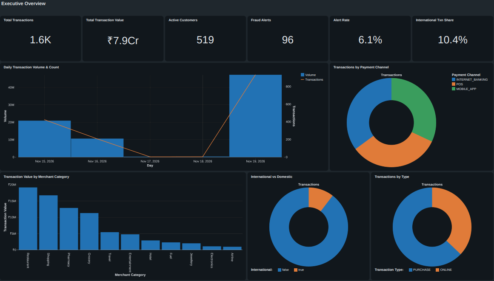
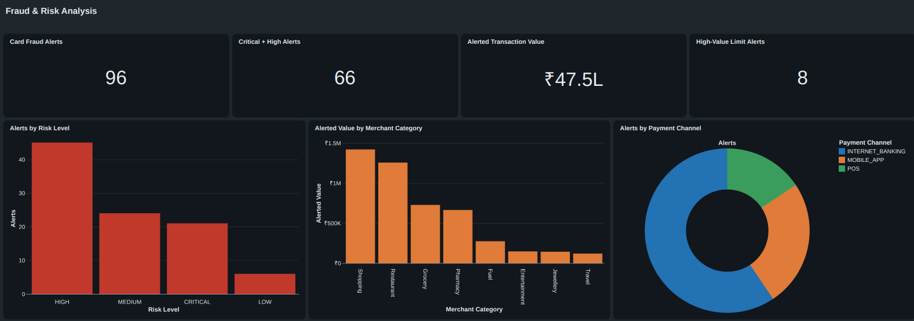
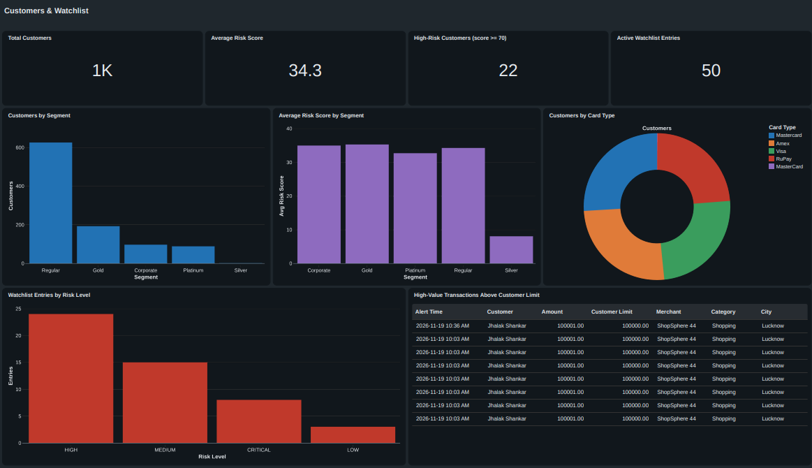

# FinGuard Streaming Pipeline

FinGuard is a real-time credit-card transaction monitoring pipeline. It generates
normal and fraud-oriented transactions, publishes them to Kafka, processes the
stream with Databricks Lakeflow Declarative Pipelines, and produces fraud,
high-value, watchlist, and transaction-volume alerts.

The project is organized as a reproducible streaming-data demonstration:

```text
Kafka producers
      |
      v
Databricks Bronze -> Silver -> Gold -> Email alert sinks
      |
      v
Fraud monitoring tables and operational alerts
```

## What this project demonstrates

- Synthetic customer, merchant, and transaction generation
- Confluent Kafka publishing over SASL/SSL
- Fraud scoring based on transaction context and customer history
- Databricks Structured Streaming ingestion from Kafka
- Delta Live Tables/Lakeflow pipeline transformations
- Bronze, Silver, and Gold data layers
- Fraud-watchlist matching and customer enrichment
- High-value transaction and transaction-volume monitoring
- Email notifications through Gmail SMTP
- PostgreSQL scripts for historic and incremental customer data

## Architecture

### 1. Transaction generation

The [`kafka_producer/`](./kafka_producer/) package creates deterministic synthetic
datasets and JSON transaction events:

- `producer_normal.py` continuously emits normal transactions.
- `producer_fraud_transaction.py` emits a high-value fraud scenario.
- `producer_fraud_card.py` emits a transaction using a fixed test card number
  for card-watchlist testing.
- `fraud_engine.py` evaluates signals such as high-value activity, impossible
  travel, new devices, risky or blacklisted merchants, international activity,
  velocity, and card testing.

Customer and merchant CSV files are generated under
[`kafka_producer/data/`](./kafka_producer/data/).

### 2. Bronze layer

The Databricks bronze flows read Kafka messages and fraud-watchlist files with
minimal transformation while preserving ingestion metadata:

- [`transactions_bronze.py`](./databricks%20notebooks%20and%20pipelines/finguard_streaming/bronze/transactions_bronze.py)
  reads the configured Kafka topic.
- [`fraud_watchlist_bronze.py`](./databricks%20notebooks%20and%20pipelines/finguard_streaming/bronze/fraud_watchlist_bronze.py)
  ingests watchlist records.

### 3. Silver layer

Silver flows parse JSON, apply data-quality expectations, and expose typed
streaming tables:

- [`transactions_silver.py`](./databricks%20notebooks%20and%20pipelines/finguard_streaming/silver/transactions_silver.py)
- [`fraud_watchlist_silver.py`](./databricks%20notebooks%20and%20pipelines/finguard_streaming/silver/fraud_watchlist_silver.py)
- [`customers_silver.py`](./databricks%20notebooks%20and%20pipelines/finguard_customers_silver_ingestion/silver/customers_silver.py)

The configured catalog and schemas are represented by tables such as:

```text
finguard.bronze.transactions
finguard.bronze.fraud_watchlist
finguard.silver.transactions
finguard.silver.fraud_watchlist
finguard.silver.customers
```

### 4. Gold layer and alerts

Gold flows create business-ready outputs:

- [`fraud_card_alert.py`](./databricks%20notebooks%20and%20pipelines/finguard_streaming/gold/fraud_card_alert.py)
  joins transactions to the fraud watchlist and customer data.
- [`high_value_transactions_alert.py`](./databricks%20notebooks%20and%20pipelines/finguard_streaming/gold/high_value_transactions_alert.py)
  identifies transactions above the configured customer threshold.
- [`transaciton_count_by_minute.py`](./databricks%20notebooks%20and%20pipelines/finguard_streaming/gold/transaciton_count_by_minute.py)
  aggregates transaction volume by minute.
- [`transaciton_count_by_minute_sliding_window.py`](./databricks%20notebooks%20and%20pipelines/finguard_streaming/gold/transaciton_count_by_minute_sliding_window.py)
  calculates volume over a sliding time window.

The alert sinks send notifications using:

- [`fraud_card_alert_email_notifier.py`](./databricks%20notebooks%20and%20pipelines/finguard_streaming/alert/fraud_card_alert_email_notifier.py)
- [`high_value_transaction_email_notifier.py`](./databricks%20notebooks%20and%20pipelines/finguard_streaming/alert/high_value_transaction_email_notifier.py)

## Dashboard

The published Databricks dashboard contains three monitoring views:

1. **Executive Overview** - high-level operational and risk indicators.
2. **Fraud & Risk Analysis** - fraud activity and risk-focused analysis.
3. **Customers & Watchlist** - customer and watchlist monitoring.

[Open the published FinGuard dashboard](https://dbc-75dfc534-408b.cloud.databricks.com/dashboardsv3/01f1e40991c917caa985c931c9d9343b/published?o=7474644461688002)

### Executive Overview



### Fraud & Risk Analysis



### Customers & Watchlist



## Repository structure

```text
.
├── databricks notebooks and pipelines/
│   ├── finguard_streaming/
│   │   ├── bronze/
│   │   ├── silver/
│   │   ├── gold/
│   │   └── alert/
│   ├── finguard_customers_silver_ingestion/
│   ├── fraud_watchlist_file_generator/
│   └── 01_kafka_streaming_test.py
├── kafka_producer/
│   ├── data/
│   ├── src/kafka_producer/
│   ├── config.py
│   ├── fraud_engine.py
│   ├── producer_normal.py
│   ├── producer_fraud_transaction.py
│   ├── producer_fraud_card.py
│   ├── requirements.txt
│   └── pyproject.toml
├── postgres sql/
│   ├── customers_historic.sql
│   └── customers_incremental.sql
└── dashboard/
```

The dashboard is a monitoring layer and is not required to run the Kafka
producers or the Databricks streaming pipeline.

## Prerequisites

- Python 3.13 or newer
- A Kafka cluster that supports SASL/SSL authentication
- Databricks with Unity Catalog and Lakeflow Declarative Pipelines enabled
- A Databricks secret scope named `finguard-scope`
- Gmail SMTP credentials configured as a secret for email notifications
- Optional: PostgreSQL/Neon for the customer SQL scripts

## Create free Kafka credentials with Confluent Cloud

The producer and Databricks notebooks are designed to connect to Confluent
Cloud. You can start with Confluent's free offer or trial, subject to the
current account limits and availability.

1. Open [Confluent Cloud](https://www.confluent.io/) and select **Try for
   Free**.
2. Create an account and open the Confluent Cloud Console.
3. Create an environment and a Kafka cluster. Choose the **Free** cluster
   option when it is available for your account.
4. Create a topic named `credit_card_transactions`, or use the topic name you
   plan to set in `TOPIC_NAME`.
5. Open the cluster's **API keys** or **Access** page and create a key with
   permission to produce and consume from the topic.
6. Copy the cluster bootstrap endpoint. It looks similar to
   `pkc-xxxxx.region.provider.confluent.cloud:9092`; this is the value for
   `bootstrap_servers`, not the Confluent website URL.
7. Copy the API key and API secret when they are displayed. The secret may only
   be shown once.

Use the values in `kafka_connection_details` for Databricks:

```json
{
  "bootstrap_servers": "pkc-xxxxx.region.provider.confluent.cloud:9092",
  "api_key": "your-confluent-api-key",
  "api_secret": "your-confluent-api-secret",
  "topic": "credit_card_transactions"
}
```

For the local producer, use the same values in `kafka_producer/.env`:

```env
BOOTSTRAP_SERVERS=pkc-xxxxx.region.provider.confluent.cloud:9092
API_KEY=your-confluent-api-key
API_SECRET=your-confluent-api-secret
TOPIC_NAME=credit_card_transactions
```

Free accounts and clusters have usage, retention, and availability limits that
can change. Check the current [Confluent Cloud pricing and free offer
details](https://www.confluent.io/confluent-cloud/pricing/) before deployment.
Do not publish API keys, API secrets, or the `.env` file to GitHub.

## Configure the Kafka producer

From the project root, move into the producer directory and create
`kafka_producer/.env`:

```env
BOOTSTRAP_SERVERS=your-bootstrap-server:9092
API_KEY=your-kafka-api-key
API_SECRET=your-kafka-api-secret
TOPIC_NAME=credit_card_transactions
TRANSACTIONS_PER_SECOND=5
FRAUD_PERCENTAGE=0.08
TOTAL_CUSTOMERS=1000
TOTAL_MERCHANTS=200
RANDOM_SEED=42
```

Never commit `.env`, Kafka credentials, database connection strings, or email
app passwords. Use a secret manager for shared or deployed environments.

### Install dependencies

Using `venv` and `pip`:

```powershell
cd "kafka_producer"
python -m venv .venv
.\.venv\Scripts\Activate.ps1
pip install -r requirements.txt
```

The repository also contains `pyproject.toml` and `uv.lock` for workflows using
`uv`.

### Run a producer

Run one producer at a time, or use separate terminals when intentionally
combining normal and test traffic:

```powershell
python producer_normal.py
python producer_fraud_transaction.py
python producer_fraud_card.py
```

Stop a producer with `Ctrl+C`; the producer flushes pending Kafka messages
before exiting.

## Configure Databricks

1. Create or select the `finguard` catalog and the required schemas.
2. Upload the files under
   [`databricks notebooks and pipelines/`](./databricks%20notebooks%20and%20pipelines/)
   to the Databricks workspace or repository.
3. Configure the `finguard-scope` secret scope.
4. Store Kafka connection details under the key
   `kafka_connection_details` as JSON:

   ```json
   {
     "bootstrap_servers": "your-bootstrap-server:9092",
     "api_key": "your-kafka-api-key",
     "api_secret": "your-kafka-api-secret",
     "topic": "credit_card_transactions"
   }
   ```

5. Configure the watchlist volume paths used by
   [`04_Autoloader_test.py`](./databricks%20notebooks%20and%20pipelines/04_Autoloader_test.py).
6. Configure the Gmail app password secret used by the email notifier flows.
7. Deploy the bronze, silver, gold, and alert flows as a Databricks pipeline.
8. Use [`01_kafka_streaming_test.py`](./databricks%20notebooks%20and%20pipelines/01_kafka_streaming_test.py)
   to validate Kafka connectivity and inspect sample records before enabling
   the complete pipeline.

The Databricks notebooks use secret references and placeholder paths; update
catalog, volume, checkpoint, and notification settings for your workspace.

## Fraud-watchlist data

The generator at
[`fraud_watchlist_data_generator.py`](./databricks%20notebooks%20and%20pipelines/fraud_watchlist_file_generator/fraud_watchlist_data_generator.py)
creates watchlist input data. The sample CSV is stored at
[`fraud_watchlist.csv`](./databricks%20notebooks%20and%20pipelines/fraud_watchlist_file_generator/fraud_watchlist.csv).

Use the Auto Loader flow to place new watchlist files in the configured source
volume and allow the bronze and silver flows to process them.

## PostgreSQL customer data

The [`postgres sql/`](./postgres%20sql/) directory contains example scripts for:

- Loading historic customer data with `customers_historic.sql`
- Applying incremental inserts and updates with `customers_incremental.sql`

Review and parameterize these scripts for your own database before execution.
They are not required to run the Kafka producer or Databricks streaming flows.

## Data and security notes

- All producer data is synthetic and intended for development or demonstration.
- Do not use real card numbers, customer information, or production credentials.
- Card numbers should be masked in logs, dashboards, and notification content.
- Keep Kafka, database, and email secrets in environment variables or Databricks
  secrets rather than source files.
- Review email recipients and SMTP settings before enabling alert sinks.

## Troubleshooting

- **Missing environment variables:** verify `BOOTSTRAP_SERVERS`, `API_KEY`, and
  `API_SECRET` in `kafka_producer/.env`.
- **No Kafka records:** confirm the topic name, cluster permissions, producer
  status, and the Databricks `kafka_connection_details` secret.
- **Malformed Silver records:** inspect the JSON payload produced by the Kafka
  scripts and the expectations in `transactions_silver.py`.
- **No emails:** verify the Gmail app password secret, sender configuration,
  recipient email fields, and SMTP access.
- **Checkpoint or volume errors:** update the `/Volumes/finguard/...` paths to
  locations available in your Databricks workspace.

